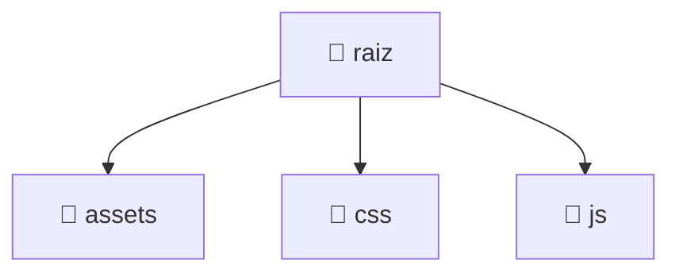

# Contexto do Projeto para IA Generativa

> Gerado em 2026-10-19 13:20:59 UTC.
> Cole este arquivo em qualquer chatbot de IA (ChatGPT, Claude, DeepSeek, Gemini...).

---

## 1. Visão Geral

- **Diretório raiz:** `.`
- **Arquivos:** 16
- **Diretórios:** 3
- **Linguagens detectadas:** js 

---

## 2. Estrutura de Diretórios

```
.
├── .claude
│   └── settings.local.json
├── .git
│   ├── gk
│   │   └── config
│   ├── hooks
│   │   ├── applypatch-msg.sample
│   │   ├── commit-msg.sample
│   │   ├── fsmonitor-watchman.sample
│   │   ├── post-update.sample
│   │   ├── pre-applypatch.sample
│   │   ├── pre-commit.sample
│   │   ├── pre-merge-commit.sample
│   │   ├── pre-push.sample
│   │   ├── pre-rebase.sample
│   │   ├── pre-receive.sample
│   │   ├── prepare-commit-msg.sample
│   │   ├── push-to-checkout.sample
│   │   ├── sendemail-validate.sample
│   │   └── update.sample
│   ├── info
│   │   └── exclude
│   ├── logs
│   │   ├── refs
│   │   │   ├── heads
│   │   │   │   └── main
│   │   │   └── remotes
│   │   │       └── origin
│   │   │           └── main
│   │   └── HEAD
│   ├── objects
│   │   ├── 01
│   │   │   └── 2e1263b553a02f92cdfcc440925a15f3d4b750
│   │   ├── 04
│   │   │   └── 93e296c5db8d31c4d2ad826fe83a69328d1d61
│   │   ├── 05
│   │   │   └── 434a71c6ba4a77d82ec617701da8c5353008b6
│   │   ├── 08
│   │   │   └── d9f237a40c93ab64d68a225da55d3e46580b60
│   │   ├── 09
│   │   │   └── 36ef51b1d63550949fbc74d2a183595a86fa0f
│   │   ├── 0c
│   │   │   └── 5ad95f58ff1d2cc61f29bdf1f26ef1ae08d061
│   │   ├── 0d
│   │   │   └── 11a7a1d58474da267b1a252f8b6047371d6783
│   │   ├── 0e
│   │   │   └── d7a8b6267e311518e26d70618abcca905a8b7e
│   │   ├── 14
│   │   │   └── c57b0f29d608b632886ac0c0733589e517b83d
│   │   ├── 17
│   │   │   └── e5c02aa3809809f6cb7e2f8650598f26de2340
│   │   ├── 1c
│   │   │   └── d51b085f560ddb7255d75b244f9e178cf706b5
│   │   ├── 23
│   │   │   └── 83cac57e002ea4c3a4503cbaf0655f4a6aa342
│   │   ├── 26
│   │   │   ├── 185a7cbc1ddd1822590a9df45992fd2f3a67cc
│   │   │   └── 791a0313486f00810619317137de18c733e18f
│   │   ├── 2c
│   │   │   └── a874547b897585fe1ec98a72fde32cfa99b585
│   │   ├── 2d
│   │   │   └── a8e54df3b86b9beb07f33f5151a9244c48c72d
│   │   ├── 2f
│   │   │   └── 745ddd9c0035550922cccd117bba08a523256e
│   │   ├── 30
│   │   │   └── 96031d427dcde90485c836a37c14163ae142df
│   │   ├── 3c
│   │   │   └── 9fec7492e0e7dd4c6742a2f490b08a34c86606
│   │   ├── 3f
│   │   │   └── 39e8be114e0c88652f1d9e42e75c50d0bb508e
│   │   ├── 43
│   │   │   └── 25ece63f7304b7f957ef77289dbe0fc66af340
│   │   ├── 44
│   │   │   └── b6c34526683a7e6076a276a55f0b3da4743280
│   │   ├── 45
│   │   │   └── 3bc0bcce943f3ad5c59dea71fce720235670e0
│   │   ├── 47
│   │   │   └── 7e5420e40cf001d42a0794e81b6d0ba8ba1777
│   │   ├── 49
│   │   │   └── 6a663d13c12e83a395d6b1993b2bb920b902e0
│   │   ├── 56
│   │   │   ├── c2813cfd4c8ac1af7be011eee3492d99bd8be5
│   │   │   └── ff095c303090cb80364ad87816f423a982ac95
│   │   ├── 58
│   │   │   └── c25ecc0920c906f120553dcf046ff2f82d912e
│   │   ├── 5f
│   │   │   └── 19cc9c44b780eb90819cda859f7524b3fc8053
│   │   ├── 61
│   │   │   └── 17ef7580f121a2a5c3ce47a035a9e3028b33eb
│   │   ├── 62
│   │   │   └── ca7242dacf32dc9b52e6368e7794a2b554a813
│   │   ├── 64
│   │   │   └── 1a7f1f502072f3066afc4c500a205284b43aa0
│   │   ├── 66
│   │   │   └── 4769b41643e7422ff33748e973bf652a03e91c
│   │   ├── 69
│   │   │   ├── 1ff8380226b1704449b3dd3a41e7861e78b484
│   │   │   └── 6e9c547586e20d4dc17b91948eea6f45101c66
│   │   ├── 6c
│   │   │   └── 2871b4ede471359e4035328680a4d7cb0f5cac
│   │   ├── 70
│   │   │   └── 8ba4a6484e1b4841a62f2d5c6e09e4a593b63f
│   │   ├── 73
│   │   │   └── 1eaa6f4bc13abbe93f23b9d4a0e88366ccab8c
│   │   ├── 74
│   │   │   └── 00c2f3e56313bfc545e261dcd7bfc8e56d07f2
│   │   ├── 7c
│   │   │   └── 2401aec09acd1348499d59744f5bab0e1010cd
│   │   ├── 7f
│   │   │   ├── 784b632b83aa447822aaffe9929b674848d776
│   │   │   └── 97b2fdcb36740b07897b178174dabf896717cd
│   │   ├── 81
│   │   │   └── 3f8526c94bc7dcd7fa6ea7f72e72847605ead0
│   │   ├── 83
│   │   │   └── 42240c5bc575039fc080dfb96378cfac64e03c
│   │   ├── 91
│   │   │   └── 3ced7869ec0d1a44d39b76ae4932be362eff68
│   │   ├── 94
│   │   │   └── 009e3f29002bf2783d8dae28a27db436b9b274
│   │   ├── 99
│   │   │   └── c5822ce871274623b5866e4f76b85c2b578476
│   │   ├── 9a
│   │   │   └── 19f9b518d87efae8b59c02f06e7f8faf25a146
│   │   ├── 9b
│   │   │   └── d0902ef10140c496a84397e060c038e545e142
│   │   ├── 9f
│   │   │   └── ec857da239270264e65be2761e5d316676e5c6
│   │   ├── a0
│   │   │   └── 226727807c23f1fcff09ab3015ed0d852f02b2
│   │   ├── a2
│   │   │   └── 4f5dd1027f561589bd89c0a7db547839683dbc
│   │   ├── a5
│   │   │   └── 0c726ab31f6ac9f61ff489cb182c8014402385
│   │   ├── aa
│   │   │   └── 8c4fcd0b70510342414a19d246d65a1efdbd89
│   │   ├── ae
│   │   │   └── 5e860e4f954831be4bdab2451634a7b8fe71a0
│   │   ├── b5
│   │   │   └── cd3f3dfdb75f2516b9f249d320de17ac68c0b1
│   │   ├── b6
│   │   │   └── fdf70271e46624bfb5855f1e5d2ea68b59d02c
│   │   ├── b7
│   │   │   └── 00b679282e9286c76944ccfdac3db75c70472d
│   │   ├── ba
│   │   │   └── 48869c9aeb39a61e294a855f28238817b30da8
│   │   ├── bb
│   │   │   └── 045e49d24d86b4a0b58a44c882474b42cf8cc6
│   │   ├── bf
│   │   │   └── bdda00960b6fcd4f1598146d6af73d789d99e2
│   │   ├── c0
│   │   │   └── be3b9946f69640732870821043cacef66ab145
│   │   ├── c1
│   │   │   └── f95228988203dba85f06b7cdfae062c89bd2b7
│   │   ├── c2
│   │   │   ├── 53ca58542eb056c5984ce69127217c021e2b9e
│   │   │   └── 79da65af644b1e3dc5746605bc8960c8bbfea5
│   │   ├── c5
│   │   │   └── 281b9a815111e64f3ebd5637d9229f71c495bb
│   │   ├── c7
│   │   │   ├── 4fef5cfa9b47fe7a8583853d9770dd93226b40
│   │   │   └── 57359b3fc77722b68d1ea6dc4b0f75f8fa1b26
│   │   ├── c8
│   │   │   └── 95f3b1ec23fd7c3f5675442c9d85c406b3eaa0
│   │   ├── cd
│   │   │   └── 1615b302c40a42f007cb9b37b09d10fc3c804e
│   │   ├── d0
│   │   │   └── c2f0e6d63daf48d2683fae80afd69a3e4c36bf
│   │   ├── d1
│   │   │   └── 8c6467dc881d7b8b02514822bea4fee065d71d
│   │   ├── d3
│   │   │   ├── 30bca8329a1dd396045187d6d91cc547d6aa7f
│   │   │   └── 44e467458bf0a3f38a0f3e169d5171f7e1b0fb
│   │   ├── d8
│   │   │   └── 4ff11e8d0e8566f9b59f671da9cc875b48d929
│   │   ├── dd
│   │   │   └── e74247d8dfc721a7cfa89609d2520e0caddadc
│   │   ├── e3
│   │   │   └── de280c775a8cab4efc966008bd03c453cc5040
│   │   ├── e4
│   │   │   ├── 0e0a20be34e77b0f80784dad5abc2fbfd8e943
│   │   │   ├── 3c5c79552728420f3b494060eaa81a04594bd2
│   │   │   └── fdf3d4df2b04bef65467fce5f7bb7aadb06d57
│   │   ├── e5
│   │   │   └── ce3410fe9ddaf300213db11fa7ec0269ae9e1d
│   │   ├── e6
│   │   │   └── 9de29bb2d1d6434b8b29ae775ad8c2e48c5391
│   │   ├── e7
│   │   │   ├── 2c78c2d8b9873b8f0dd1cc0dbc624ed8781fec
│   │   │   ├── 985f7c20d21ab7055244df5ff40ec4eedbe447
│   │   │   └── c6431f8dc39e97d8d9a3645dcb7276d514a2fc
│   │   ├── e9
│   │   │   └── 7f2cd2197313d1ecc14200484c632f2e7a542e
│   │   ├── eb
│   │   │   └── aa6621d0346370a4fc36034aa07f95b561ac68
│   │   ├── ed
│   │   │   └── 13b76fa4455eb8669f07efdd8881473b71fd18
│   │   ├── ef
│   │   │   └── 72b651e3f10e766c1ff38931e4b1a581270848
│   │   ├── f2
│   │   │   └── ddc0b2f3fb63f3f305d1d73c95371b9f8af517
│   │   ├── f4
│   │   │   └── 4078420abca004c04be650350d988a5480011f
│   │   ├── f5
│   │   │   └── 4155709d210684e3141bc1bb0a56ee2c29eefd
│   │   ├── f6
│   │   │   └── 994f352df0fb7c27ece6811353a4db641f60f1
│   │   ├── f8
│   │   │   └── 0ab76ec74b9fe887221847d6528a8603a9b483
│   │   ├── fb
│   │   │   └── e60bae68ae3dcab3181b9e684f0a8d8f9fef84
│   │   └── info
│   │       └── commit-graphs
│   │           ├── commit-graph-chain
│   │           ├── graph-06da9e47c4b9f7214d4a61ce2a3503ec600f1acd.graph
│   │           └── graph-d9f3323159fb19593f9278c48be0a484ff1b86ac.graph
│   ├── refs
│   │   ├── heads
│   │   │   └── main
│   │   └── remotes
│   │       └── origin
│   │           └── main
│   ├── COMMIT_EDITMSG
│   ├── HEAD
│   ├── config
│   ├── description
│   └── index
├── assets
│   ├── pug-logo.svg
│   └── pug.png
├── css
│   ├── codemirror.css
│   ├── components.css
│   ├── layout.css
│   ├── responsive.css
│   └── tokens.css
├── js
│   ├── app.js
│   ├── compile.js
│   ├── config.js
│   ├── editor.js
│   └── utils.js
├── README.md
├── index.html
├── netlify.toml
└── script.sh
```

---

## 3. Diagrama Mermaid



---

## 4. Arquivos e Metadados

| Arquivo | Tamanho | Linhas |
|---|---|---|
| `README.md` | 2391 bytes | 62 linhas |
| `assets/pug-logo.svg` | 7377 bytes | 117 linhas |
| `assets/pug.png` | 906 bytes | 2 linhas |
| `css/codemirror.css` | 1970 bytes | 47 linhas |
| `css/components.css` | 9460 bytes | 287 linhas |
| `css/layout.css` | 1354 bytes | 44 linhas |
| `css/responsive.css` | 3236 bytes | 91 linhas |
| `css/tokens.css` | 3040 bytes | 99 linhas |
| `index.html` | 13417 bytes | 216 linhas |
| `js/app.js` | 20944 bytes | 497 linhas |
| `js/compile.js` | 3667 bytes | 96 linhas |
| `js/config.js` | 3874 bytes | 33 linhas |
| `js/editor.js` | 5677 bytes | 98 linhas |
| `js/utils.js` | 775 bytes | 27 linhas |
| `netlify.toml` | 780 bytes | 28 linhas |
| `script.sh` | 6808 bytes | 217 linhas |

---

## 5. Dependências Detectadas (amostra)

```

```

---

## 6. Instruções para a IA

1. A estrutura segue a árvore e o diagrama Mermaid acima.
2. As dependências são aproximadas (grep), não substituem o gerenciador real.
3. Priorize arquivos com mais linhas ao analisar a lógica principal.
4. Foque em `src/`, `lib/` ou equivalente se o projeto for grande.

*Fim do contexto.*
