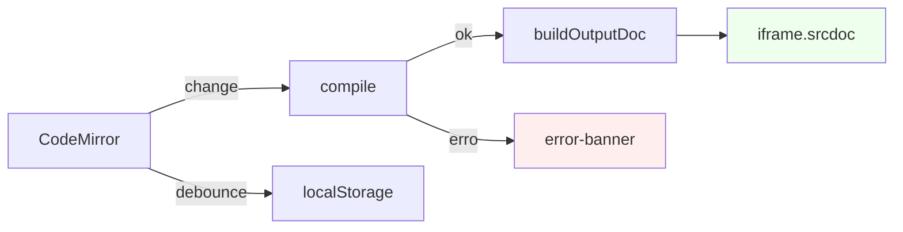

# Pug Render — Handoff

> [!NOTE]
> Playground single-file (`index.html`) com CodeMirror + Pug em iframe sandbox. Zero build.

---

## 🏗️ Arquitetura



> [!IMPORTANT]
> Fluxo único: **editor → compile → buildOutputDoc → iframe**. Se você vir `iframe.srcdoc` em qualquer outro lugar, é bug.

---

## 🔒 Segurança

> [!CAUTION]
> `sandbox="allow-scripts allow-popups allow-forms"` — **sem** `allow-same-origin`.
> Juntar `allow-same-origin` + `allow-scripts` deixa o código do preview escapar do iframe.

---

## ✅ Correções aplicadas

| # | Fix | Tag |
|---|---|---|
| 1 | Sandbox sem `allow-same-origin` | Poka-yoke |
| 2 | `buildOutputDoc()` como fonte única | Poka-yoke |
| 3 | Guard `typeof CodeMirror` no `defineMode` | Jidoka |
| 4 | `beforeunload` com `persistedOk` + `lastSavedValue` | Jidoka |
| 5 | `pointer-events:none` no iframe durante drag | Poka-yoke |
| 6 | `requestAnimationFrame` no `editor.refresh()` | Muda |
| 7 | Listeners de drag nomeados e removidos | Muda |
| 8 | `aria-live` + `aria-label` + `title` | Andon |
| 9 | `compile()` pura (testável) | Jidoka |
| 10 | `FILE_META` só `.pug` | 5S |
| 11 | Ícone SVG multi-cor do Pug | — |

---

## 🚀 Uso

| Atalho | Ação |
|---|---|
| `Ctrl+Enter` | Compilar agora |
| `Ctrl+S` | Baixar `output.html` |
| Duplo clique no divisor | 50/50 |
| Drag no divisor | Redimensionar |

---

## 🐛 Troubleshooting

> [!WARNING]
> **"Carregando…" travado** → todos os 5 CDNs de `pug` caíram. Libere `esm.sh`, `cdn.jsdelivr.net`, `unpkg.com`, `cdn.skypack.dev`, `bundle.run`.

> [!WARNING]
> **"salvar: off"** → `localStorage` bloqueado (modo privado). `beforeunload` sempre avisa antes de fechar.

> [!NOTE]
> **Preview branco** → abra o Console **no contexto do iframe** (dropdown do DevTools).

---

## 🔮 Roadmap

- **P1** — `postMessage` para capturar erros dentro do iframe (validar `event.source`)
- **P2** — CSP mínima no parent
- **P2** — Vitest em `compile()` e `buildOutputDoc()`

---

## 📁 Símbolos-chave

```
CONFIG              constantes globais
compile(src)        puro → { ok, html|error, elapsed }
buildOutputDoc(h)   fonte única de saída
boot()              orquestrador
showCritical(errs)  tela de falha total
```
